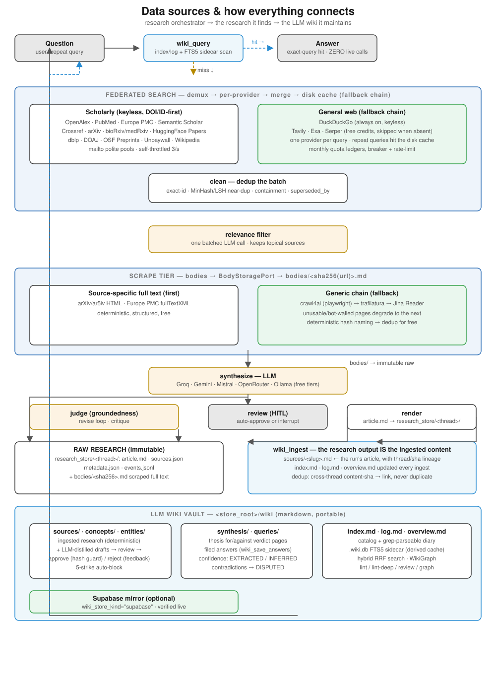

# Data sources &amp; how everything connects

**One sentence:** the orchestrator *finds* research across many live sources,
scrapes full text, synthesizes an article, and **files that research output
straight into a persistent LLM wiki** — so the next question answers from the
wiki, not from the internet.

This document explains every data source, how it connects, and how the pieces
become the wiki. The authoritative code map is `src/knowledge_engine/`
(ports in `core/ports.py`, adapters in `infrastructure/`, nodes in
`orchestration/`); the human overview is `docs/MR-LLM-WIKI.md`.

## The connection diagram

Read it top-to-bottom: a question consults the wiki first; a miss fans out
through federated search and the scrape tier; the synthesized article is
rendered to the raw store; then **that same article is ingested into the
wiki** (sources/ page + index/log/overview) and optionally compiled into
concept/entity/thesis/query pages.

## The core mapping (state it once, remember it everywhere)

| Layer | Location | Who writes it | Editable? |
|---|---|---|---|
| **Raw research** | `research_store/<thread>/` (`article.md`, `sources.json`, `metadata.json`, `events.jsonl`) + `bodies/<sha256>.md` | the orchestrator | never |
| **Wiki (ingested)** | `<store_root>/wiki/sources/<slug>.md` + `index.md` `log.md` `overview.md` | the engine | engine-only |
| **Wiki (compiled)** | `concepts/` `entities/` `synthesis/` `queries/` | engine + opt-in LLM (reviewed) | engine + human review |
| **Derived cache** | `.wiki.db` (FTS5, hybrid RRF) | engine | rebuild anytime |
| **Cloud mirror** | Supabase `wiki` bucket | engine | engine-only |

**The research the agent finds IS the content the wiki ingests.**

## 1. Federated scholarly search (keyless, DOI/ID-first)

`DemuxSearchAdapter` fans one query across providers, normalizes every hit
into a single `SourceRecord` (id, doi, title, authors, year, abstract,
venue, citations), then `merge_sources` dedups by id. Costs nothing per
lookup; the mailto polite pools and per-provider rate limits protect you.

| Source | Role | Auth / limit |
|---|---|---|
| **OpenAlex** | DOI-first metadata backbone (free, un-metered per-ID lookups) | mailto polite pool |
| **PubMed** (E-utilities) | biomedical depth, 33M+ records, MeSH | keyless, self-throttled 3/s |
| **Europe PMC** | biomedical + OA full-text links | keyless |
| **Semantic Scholar** | influence/citation signal | keyless (shared quota, breaker-protected) |
| **Crossref** | DOI registry fallback (fetch + validate) | mailto polite pool |
| **arXiv** | physics/math/CS preprints | keyless |
| **bioRxiv / medRxiv** | life-science preprints | keyless |
| **HuggingFace Papers** | community-ranked ML papers + code links | keyless |
| **dblp** | CS bibliography, venue metadata | keyless (degrades gracefully) |
| **DOAJ** | OA journals, full-text links | keyless |
| **OSF Preprints** | cross-discipline preprints | keyless |
| **Unpaywall** | legal OA PDF resolution by DOI (fetch) | `UNPAYWALL_EMAIL` |
| **Wikipedia** | general-knowledge fallback (MediaWiki API) | keyless |

## 2. General-web search (fallback chain)

A single sequential chain — **DuckDuckGo → Tavily → Exa → Serper** — wrapped
in a disk cache, so a query spends at most one provider's quota and repeat
queries spend none. Each keyed provider has a persisted monthly ledger; an
exhausted or rate-limited provider is skipped until it refills. If a source
fails, that is reported and the chain continues — never silently faked.

## 3. Relevance filter

One batched LLM call keeps only topical sources (`RelevanceNode`), so the
bodies stage never wastes budget on off-topic hits.

## 4. Scrape tier (URL → LLM-ready Markdown)

`ScrapeRouter` tries source-specific full text first, then a generic chain:

1. **arXiv / ar5iv HTML**, **Europe PMC fullTextXML** — deterministic,
   structured, free.
2. **crawl4ai** (Playwright) — full browser fetch.
3. **trafilatura** — local, free extraction.
4. **Jina Reader** — remote last resort (keyless ~20 RPM, optional key).

Every body lands through `BodyStoragePort` at
`bodies/<sha256(url)>.md` — deterministic, idempotent, and
**deduped for free** (same URL → same file). A bot-walled or unusable page
degrades to the next scraper; a total failure is reported, never substituted.

## 5. LLM providers (zero-cost only)

`FallbackRouter` over free-tier adapters: **Groq, Gemini, Mistral,
OpenRouter** (free routes), **Ollama** (local). Used by relevance, synthesis,
judge, review, and the opt-in wiki compile. `harness.toml` + `profiles/*.toml`
route by capability, never by model name.

## 6. Render → raw research store

The synthesized article is rendered to
`research_store/<thread>/article.md` with YAML frontmatter + footnotes, plus
`sources.json`, `metadata.json`, and an append-only `events.jsonl`. This is
the immutable raw layer.

## 7. wiki_ingest — the research output becomes the wiki

`WikiIngestNode` runs after every finished run:

- **Guaranteed source page:** the article is filed as
  `wiki/sources/<slug>.md` with `thread`/`sha256`/`query_sha256`/`confidence`
  frontmatter — a first-class lineage pointer back to the raw run.
- **Verdicts:** NEW / UPDATE / NO_MATERIAL (unchanged content never rewrites);
  cross-thread content-sha dedup links instead of duplicating.
- **Bookkeeping:** `index.md` (catalog), `log.md` (append-only
  `## [YYYY-MM-DD] op | Title`), `overview.md` (derived).
- **Opt-in compile (per run via `RunSettings`):**
  - `wiki_extract=True` → two-step LLM compile into concept/entity **drafts**
    (review: approve with hand-edit hash guard, reject with feedback into the
    next compile, 5-strike auto-block).
  - `wiki_save_answers=True` → file the answer under `queries/`.
  - `thesis="claim"` → for/against verdict page under `synthesis/`.
  - Degrade-safe: if the LLM enrichment fails, the run still delivers its
    article + source page and records a `wiki_extract_error` note.

## 8. Derived caches and cloud mirror

- **`.wiki.db`** — a derived SQLite + FTS5 sidecar (BM25) with **hybrid RRF**
  (FTS + term-overlap fusion). Deletable and rebuildable; the vault is the
  source of truth.
- **`WikiGraph`** — nodes, wikilink edges, backlinks, shared-thread edges,
  communities; dump with `make wiki-graph`.
- **Supabase** — `wiki_store_kind="supabase"` mirrors the wiki to the `wiki`
  bucket (cross-process cache coherence); verified live; optional.

## 9. Query flow, end to end

1. `engine.wiki_query(topic)` or `research(query)` → `wiki_query` scans
   `index.md` + FTS5 sidecar.
2. **Exact-query hit** → answer from the wiki: **zero live calls**.
3. **Miss** → federated search (§1–2) → relevance (§3) → scrape (§4) →
   synthesize (§5) → judge/review → render (§6).
4. `wiki_ingest` files that research into the wiki (§7) — the loop completes
   and the next repeat question is free.

## 10. The gates that keep it honest

- Offline evals (`make evals`, 6/6): replay cassettes, bit-identical.
- Offline e2e `tests/e2e/test_wiki_hit_path.py`: the hit path is live-call-free.
- `make check`: lint/types/arch/semgrep/agents/context/test/evals/bench.
- Deterministic wiki lint (`make wiki-lint`) + opt-in LLM lint
  (`make wiki-lint-deep`).

See `docs/MR-LLM-WIKI.md` for the human overview and `docs/LLM_WIKI.md` for
the delivery plan.
