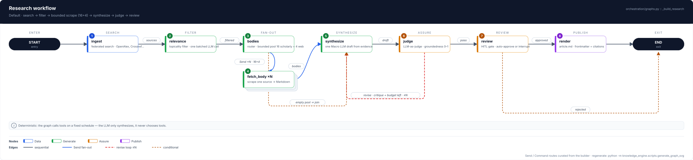
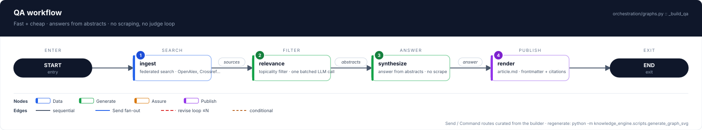
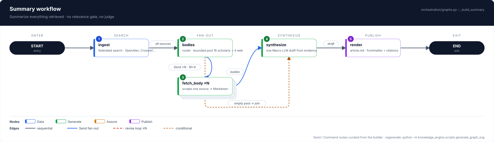
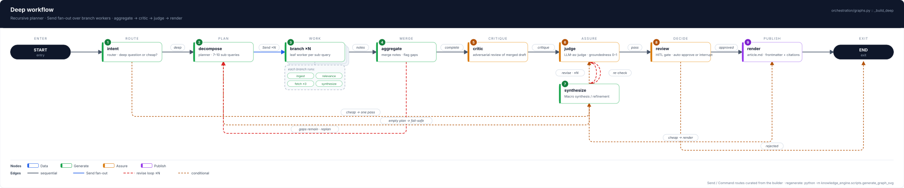

# Workflow diagrams

Professional, print-ready diagrams of the four LangGraph workflows in
`src/knowledge_engine/orchestration/graphs.py`. Same nodes, different wiring.

| Diagram | Workflow | Path in one line |
|---|---|---|
|  | `research` (default) | `ingest` → `relevance` → `bodies` → `fetch_body ×N` → `synthesize` ⇄ `judge` loop → `review` → `render` |
|  | `qa` (fast + cheap) | `ingest` → `relevance` → `synthesize` → `render` — answers from abstracts, no scraping, no judge loop |
|  | `summary` | `ingest` → `bodies` → `fetch_body ×N` → `synthesize` → `render` — no relevance gate, no judge |
|  | `deep` | `intent` → `decompose` → `branch ×N` (Send fan-out) → `aggregate` → `critic` → `judge` ⇄ `synthesize` → `review` → `render` |

`graph.svg` is a byte-identical alias of `graph-research.svg`, kept for old links.

## Reading a diagram

- **Columns run left → right in execution order** (ENTER → … → EXIT lane captions).
- **Numbered badges** mark the happy-path order; `×N` cards with stacked ghosts
  are `Send` fan-out workers (bounded: 16 scholarly + 4 general-web sources).
- **Red dashed lanes** are revise/replan loops (`judge ⇄ synthesize ≤N`,
  `aggregate → decompose`); **amber dashes** are conditional branches
  (`approved`/`rejected`, `deep`/`cheap`, empty-pool joins).
- Node colors: blue = search, green = generation/retrieval, amber = assurance
  (judge/review/critic), purple = publish, dark = control (START/END).

The key design decision, visible in every diagram: instead of giving the LLM
tools, the *graph* does the tool-calling deterministically (search/scrape nodes
run first, in fixed order, bounded) and the LLM only ever sees the finished
evidence pile. `branch` reuses the same leaf node instances as a composition,
not a copy (see `nodes/branch.py`).

## Regenerating

```bash
uv run python -m knowledge_engine.scripts.generate_graph_svg
```

This rewrites all five SVGs in this directory. `tests/unit/test_graph_svg.py`
pins the curated topology to the builders, so changing a workflow without
refreshing its diagram fails the suite — and `test_committed_diagrams_are_current`
fails if the committed SVGs drift from the renderer.

## Why curated, not auto-derived

LangGraph's `get_graph()` cannot see `Send`/`Command` dynamic routes: the bodies
fan-out, the empty-pool join, and the judge revise loop are invisible to it, and
every registered-but-unconnected node is still listed (so the old auto-layout
showed `bodies`/`judge` inside the `qa` diagram, where they never run). The specs
in `scripts/generate_graph_svg.py` (`WORKFLOW_SPECS`) are therefore curated from
the builder functions — the ground truth — with only reachable nodes, and the
tests cross-check every spec node id against the compiled graph.
